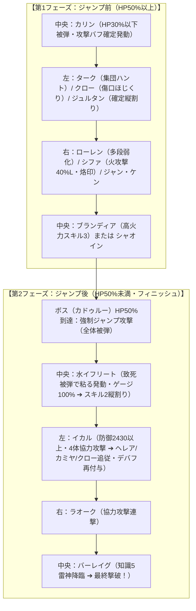

# 🔥 異界レイド ソロ編成：紅炎の魔獣（火属性20秒台最速周回・完全攻略版）

> [!IMPORTANT] 20秒台最速・事故率ゼロ化の「5大絶対法則」
> 1. **属性不利（風属性）の完全排除**：フリルレア等の風デバッファーは対火属性で「ミス判定」が発生しデバフ試行自体が100%不発。デバフ役は等倍でミス判定のない**闇属性（ヘレア、カミヤ、ジュルタン）**または火・光属性に換装！
> 2. **ブランディアと水イフ/バーレイグの速度差「約47以上」**：ボスの開幕被弾で水イフのパッシブ「粘る」が発動しゲージ100%になっても、ブランディアの前に割り込ませず確定先手でHP50%ジャンプを誘発させる。
> 3. **前半デバッファーの速度上限「170以下」**：ジュルタン、クロー、ターク、ケン等はボスより早く動きすぎると行動順チェーンが崩壊するため速度170以下を厳守。
> 4. **耐久極限カット（パッシブ・確定AIトリガー）**：
>    - カリン：★4 Lv30（HP6000前後）➔ 開幕被弾で確実にHP30%以下になり「炎のダンス（全体攻撃バフ）」を100%確定発動。
>    - 水イフリート：★5 Lv1未育成（速度+0）➔ ジャンプ攻撃被弾で100%確実に致死判定になり「粘る」発動 ➔ スキル2縦割り付与。
> 5. **アーティファクトは「火属性への与ダメUP」が絶対必須**：水属性（シャオイン）でも火属性（ブランディア）でも、対火属性ボスへの与ダメを直接乗算させるため全員に対火AFを装着（※対水与ダメは火レイドで無効）。

---

## 1. 2フェーズ連動型アーキテクチャ概要

---

## 2. 確定パーティ編成一覧（3パーティ × 6体＝18体）

### パターンA：最速20秒台ハイエンド構成（ブランディア＆イカル4体協力軸）

| チーム | 役割 | リーダー（LS） | 前衛 (Frontline) | 後衛 (Backline) |
|---|---|---|---|---|
| **中央 (TEAM 1)** 削り＆フィニッシュ | 攻バフ・ジャンプ誘発・知識大砲 | **ファミー** (クリダメ25%UP) ※代用: カーリー / シファ | **カリン** (★4 Lv30) **水イフ** (★5 Lv1未育成) **デボラ** (闇サイコロ / 置物) | **ブランディア** (メイン削り) **バーレイグ** (知識5フィニッシャー) **ファミー** (置物闘志) |
| **左 (TEAM 2)** 開幕デバフ＆4体協力 | 闇デバフ・烙印・ジャンプ後4体連撃 | **ジュルタン** (闇ダンジョン速度23%) または **ケン** (攻撃33%) | **イカル** (防御2430以上) **ジュルタン** (開幕確定盾割り) **ドローガン** (被弾時デバフ置物) | **ターク** (集団ハント) **クロー** (傷口ほじくり烙印) **ヘレア** (闇ハルピュイア / 盾割り烙印) |
| **右 (TEAM 3)** デバフ維持＆ダメ押し | 確定多段弱化・安全装置・連撃 | **シファ** (火属性攻撃40%UP) または **カーリー** (火攻撃40%UP) | **ローレン** (クリダメ型多段盾割り) **ラオーク** (協力攻撃連撃) **水ガーゴイル** (開幕石像化置物) | **シファ** (火攻撃40%L・多段烙印) **ジャン** (火インプ高打点) / **ケン** **プリア** (開幕即死・弱化全解除安全装置) |

---

### パターンB：無課金・純5不要型 20秒台再現構成（シャオイン＆カーリー軸）
*※ブランディア未所持、デボラ未所持でも完全再現可能*

| チーム | 役割 | リーダー（LS） | 前衛 (Frontline) | 後衛 (Backline) |
|---|---|---|---|---|
| **中央 (TEAM 1)** | 攻バフ・シャオイン削り・バーレイグ | **カーリー** (火属性攻撃40%UP) ※クリ率バフ供給 | **カリン** (★4 Lv30) **水イフ** (★5 Lv1未育成) **ドローガン** (闇リザードマン置物) | **シャオイン** (激怒意志・対火与ダメAF) **バーレイグ** (クリ率55%でOK) **カーリー** (攻撃・クリ率バフ) |
| **左 (TEAM 2)** | 闇デバフ・烙印・4体協力攻撃 | **ケン** (全属性攻撃33%UP・古代コイン) | **イカル** (防御2430以上) **ジュルタン** (開幕確定盾割り) **ニケル** (水リビング置物) | **ターク** (集団ハント) **クロー** (傷口ほじくり) **ヘレア** (闇ハルピュイア) |
| **右 (TEAM 3)** | 多段デバフ・協力連撃・安全装置 | **ヴェルデハイル** (ダンジョン速度28%) または **エシャリオン** | **ローレン** (クリダメ型盾割り) **ラオーク** (協力連撃) **プリア** (開幕即死・安全装置) | **カミヤ** (闇九尾・スキル1烙印) **アスター** (火魔剣士・追撃削り) **ヴィゴル** (耐久速度サポート) |

---

## 3. モンスター別 詳細ステータス閾値・ルーン厳選マトリクス

| # | 配置 | モンスター | 属性 | 星/Lv | ルーンセット | 速度調整 | 重要ステータス閾値 | 調整意図・役割 |
|---|---|---|---|---|---|---|---|---|
| 1 | 中央 | **カリン** | 火 | ★4 Lv30 | 意思 + 闘志 + 闘志 | 130〜150 | HP6000前後 (耐久極限カット) | 開幕被弾で確実にHP30%以下になり攻撃バフ確定発動 |
| 2 | 中央 | **ブランディア** | 火 | ★6 Lv40 | 激怒 + 意思 | **水イフ+47以上** (140〜150) | 攻撃+1700, クリ率76%+, クリダメ220%+ | ジャンプ前HP50%まで一撃で削る（対火与ダメAF必須） |
| 3 | 中央 | **水イフリート** | 水 | **★5 Lv1** | 意思 + 闘志 + 闘志 | **+0 (未育成)** | 体力・防御追加なし | ジャンプ被弾で確実に致死判定➔粘る発動➔ゲージ100%で盾割り |
| 4 | 中央 | **バーレイグ** | 火 | ★6 Lv40 | 激怒 + 意思 | 100〜105 (最遅) | 攻撃+1800, クリ率76%+, クリダメ230%+ | 知識5雷神降臨で最終撃破（ファミー時76%、カーリー時55%） |
| 5 | 中央 | **デボラ / ドローガン** | 闇 | ★6 / ★5 | 意思 + 闘志 + 闘志 | 任意 | 耐久確保または倒れる調整 | 被弾時パッシブでボスへ自動デバフ付与＋全体攻撃力底上げ |
| 6 | 中央 | **ファミー / カーリー** | 光/火 | ★6 Lv40 | 闘志 + 闘志 + 闘志 | 調整 | 攻撃バフ・クリダメバフ | 置物闘志役（カーリー時はアタッカークリ率敷居大幅緩和） |
| 7 | 左 | **ターク** | 水 | ★6 Lv40 | 迅速 + 意思 / 闘志 | **160〜170 (上限170)** | 攻撃+1200, クリ率76%+, クリダメ150%+ | 1番手「集団ハント」で味方3体引き連れデバフ試行 |
| 8 | 左 | **クロー** | 闇 | ★6 Lv40 | 激怒 + 刃 / 闘志 | **ブランディア直前** (145〜155) | HP+7500, 攻撃+1500, クリダメ200%+ | 2番手「傷口ほじくり」特大打点＋烙印付与。ジャンプ耐え耐久 |
| 9 | 左 | **イカル** | 水 | ★6 Lv40 | 決意 + 守護 + 闘志 | 130〜140 | **追加防御力 +2430以上 必須** | 防御2430達成でジャンプ後4体協力攻撃発動➔デバフ再付与 |
| 10 | 左 | **ジュルタン** | 闇 | ★6 Lv40 | 意思 + 闘志 + 闘志 | **165〜170 (上限170)** | 体力+20000, 効果的中45%+ | 開幕1番手で等倍ミスなし確定盾割り付与 |
| 11 | 左 | **ヘレア** | 闇 | ★6 Lv40 | 闘志 + 闘志 + 意思 | 140〜155 (上限170) | 攻撃+1200, 的中45%+ | 闇ハルピュイア。等倍ミスなしで縦割り・烙印を同時試行 |
| 12 | 左 | **ケン** | 火 | ★6 Lv40 | 激怒 + 意思 | 140〜155 (上限170) | 攻撃+1400, クリダメ180%+ | 古代コイン交換枠。同属性でミスなし烙印＋追撃削り |
| 13 | 右 | **ローレン** | 光 | ★6 Lv40 | 意思 + 闘志 + 闘志 | 150〜165 (上限170) | クリダメ型 (攻/クリダメ/HP) 的中45%+ | 多段パッシブで縦割り・減速・回復不能を鉄壁維持 |
| 14 | 右 | **シファ** | 火 | ★6 Lv40 | 闘志 + 闘志 + 意思 | 140〜155 (上限170) | 火属性攻撃40%UP (L), 的中45%+ | 火攻撃40%リーダー＋多段烙印付与 |
| 15 | 右 | **ラオーク** | 火 | ★6 Lv40 | 暴走/猛攻 + 刃 | 130〜145 | 攻撃+1300, クリダメ160%+ | ジャンプ後に協力攻撃で味方を連れて追撃削り |
| 16 | 右 | **ジャン / アスター** | 火 | ★6 Lv40 | 激怒 + 刃 | 135〜145 | 攻撃+1500, クリダメ200%+ | 単体超火力で第1フェーズ削り残しを完全防止 |
| 17 | 右 | **水ガーゴイル** | 水 | ★6 Lv40 | 意思 + 闘志 + 闘志 | 最遅 | 防御特化 | 開幕石像化により被弾時デバフ付与 |
| 18 | 右 | **プリア** | 火 | ★4〜★6 | **意思ルーン必須** | 最遅 | 耐久最低限（開幕即死調整） | 開幕被弾で即死➔味方全体弱体全解除＋ゲージUPの安全装置 |

---

## 4. 事故要因の徹底解剖と完全回避チェックリスト

| 事故パターン | 構造的原因 | 完全回避の定量的対策 |
|---|---|---|
| **事故1：第1フェーズ（HP50%前）の削り残し** | デバフ不発、アタッカー火力不足 | ① 風属性を完全排除し闇属性（ヘレア・ジュルタン）にする ② **アタッカー全員に対火属性与ダメAFを装着**（水属性でも対火UP） ③ クロー・シャオイン・ブランディアの攻撃・クリダメ底上げ |
| **事故2：ジャンプ後の縦割り不発・削り切れず** | デバッファー速度超過（170超）、協力攻撃不足 | ① **前半デバッファーの速度を170以下に制限**（ボス先行を防止） ② **イカルの追加防御力+2430以上を達成**（4体協力攻撃を確定発動） ③ 水イフ★5 Lv1未育成（ジャンプ被弾で即粘る➔ゲージ100%縦割り） |
| **事故3：水イフがブランディアの前に割り込む** | 水イフとブランディアの速度差不足 | **ブランディアと水イフ/バーレイグの速度差を「約47以上」確保する** |
| **事故4：カリンや水イフの耐久過剰でパッシブ不発** | 耐久が高すぎて致死/HP30%以下判定が出ない | ① カリンは★4 Lv30（HP6000前後）に耐久カット ② 水イフは★5 Lv1未育成（ステータス加算なし）にする |

---

## 5. 代用モンスター選定ガイド（手持ちに応じたカスタマイズ）

| 本来の最適枠 | 無課金・低レア代用枠 | 代用時の役割・強み | 注意点・ルーン調整 |
|---|---|---|---|
| **ブランディア** (火極地) | **シャオイン** (水カンフー) | 高倍率多段スキルによるジャンプ前削り役。無課金最強代替。 | 激怒+意思。攻撃力・クリダメ極限、**「対火属性与ダメUP」アーティファクト必須装着**。 |
| **デボラ** (闇サイコロ) | **ドローガン** (闇リザード) / **ニケル** (水リビ) | 被弾時パッシブでボスへ自動デバフ（攻撃低下・速度低下）を付与。 | 意思+闘志+闘志。ジャンプ攻撃に耐えうる最低限の耐久または倒れる調整。 |
| **ファミー** (光弓) | **カーリー** (火ハイエレ) / **シファ** (火九尾) | カーリーは攻撃・クリ率バフ。シファは火属性攻撃力+40%リーダー。 | カーリー採用時は**アタッカーの必要クリ率が54%〜57%前後に緩和**される。 |
| **汎用削り枠** | **ケン** (火シャドウマスター) | 古代コインで確定入手可能。等倍ミスなし烙印＋高火力。 | 速度上限170以下を守り、行動順チェーンを乱さない。 |
| **安全装置** | **プリア** (火エルフ司祭) | 開幕即死で味方全体弱体全解除＋ゲージ上昇。 | **意思ルーン装着必須**。耐久を上げすぎず確実に即死させる。 |
